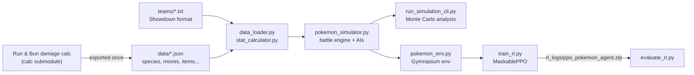

# Poke_IA: a strategic battle AI for Pokémon Run & Bun

A Python battle simulator that reproduces the mechanics and the opponent AI of **Pokémon Run & Bun** (a fan-made difficulty hack of Pokémon Emerald), used to:

1. **train a reinforcement learning agent** (MaskablePPO) to win battles against the game's AI;
2. **analyse a team before a fight** by simulating hundreds of battles (win rate, example battle, held item suggestions).

> [!IMPORTANT]
> **Development is paused.** I stopped working on this project because I ran out of personal time, not because it was finished.
> Please read it as a **personal learning and experimentation project**, not a complete or polished product. The battle mechanics are simplified, and the agent has not been trained to the point of beating the game's AI. I built it to learn reinforcement learning on a problem I enjoy, and to experiment with environment and reward design.

---

## Table of contents

- [Why this project](#why-this-project)
- [How it works](#how-it-works)
- [Project structure](#project-structure)
- [Getting started](#getting-started)
- [Usage](#usage)
- [Current limitations](#current-limitations)
- [What I would do next](#what-i-would-do-next)
- [What I learned](#what-i-learned)
- [Credits](#credits)

## Why this project

Run & Bun is known for being very hard, and many people play it as a *Nuzlocke* (a fainted Pokémon is lost forever). The opponent AI is deterministic enough that players have documented how it picks moves. That makes it a nice playground:

- the opponent's behaviour can be **re-implemented** in Python;
- battles can then be **simulated thousands of times faster** than in the game;
- which makes it possible to **train an RL agent** and to **test team choices** offline.

## How it works



### 1. Game data

`data/` contains the species, moves, items, abilities, natures and type data of Run & Bun, exported from the community [Run & Bun damage calculator](https://github.com/dekzeh/calc) (included as the `calc` git submodule). [`data_loader.py`](data_loader.py) loads each file lazily and normalises names, so that `King's Rock`, `kings-rock` and `Kings Rock` all match.

Teams are written in the standard **Pokémon Showdown export format** (see [`teams/`](teams/)). Final stats are computed from base stats, IVs, EVs, level and nature with the official formula ([`stat_calculator.py`](stat_calculator.py)).

### 2. Battle engine

[`pokemon_simulator.py`](pokemon_simulator.py) simulates 6v6 singles battles turn by turn:

- **damage formula** with STAB, the full type chart, critical hits, random damage roll, burn, weather and item multipliers (Life Orb, Choice Specs, type-boosting items...);
- **move order**: priority, Quick Claw, speed, speed ties, Chlorophyll / Swift Swim;
- **accuracy** (including Thunder/Hurricane in rain and sun), recoil, Focus Sash / Focus Band, King's Rock flinch;
- **weather** (Drought / Drizzle, Heat Rock / Damp Rock duration);
- **end of turn**: Leftovers, berries, burn and poison damage, weather countdown.

Battles take a seeded `random.Random`, so a battle can be replayed exactly.

### 3. The two AIs

| AI | Plays | How it decides |
|---|---|---|
| `RunAndBunAI` | The opponent (team 2) | Re-implementation of the in-game trainer AI, based on the community documentation of its scoring rules (v1.07). Each move gets a score: the highest-damage move scores 6 (80% of the time) or 8 (20%), a move that KOs gets a bonus (bigger if the AI is faster), setup and hazard moves get fixed scores, recoil is penalised... After a KO, the replacement is chosen with the documented switch-in scores (faster and OHKOs = 5, slower but OHKOs without being OHKO'd = 4, etc.). |
| `SmartAI` | Team 1 in pure simulations | A heuristic AI I wrote: it scores every move by % damage dealt (adjusted for speed and for the risk of being KO'd first) and every possible switch by offence, defence, immunities and Intimidate. It switches when the best switch is clearly better than the best attack. It is the baseline the RL agent should eventually beat. |

### 4. Reinforcement learning environment

[`pokemon_env.py`](pokemon_env.py) wraps the simulator as a [Gymnasium](https://gymnasium.farama.org/) environment where the agent controls team 1 against `RunAndBunAI`. One step is one turn.

| | |
|---|---|
| **Observation** | 106 floats: HP ratio of both active Pokémon, their types (one-hot), their status (one-hot), the HP ratio of every benched Pokémon (`-1` for empty slots) and their scaled Attack / Defense / Speed. |
| **Actions** | 9 discrete actions: use move 1-4, or switch to bench Pokémon 1-5. |
| **Action masking** | `action_masks()` marks missing moves and fainted / empty bench slots as invalid. **MaskablePPO** (from `sb3-contrib`) only samples valid actions, which removes a lot of wasted exploration. |
| **Episode end** | One team is fully fainted, or 200 turns are reached (truncation). |

**Rewards**, designed around a Nuzlocke mindset where losing a Pokémon matters more than winning fast:

| Event | Reward |
|---|---|
| Opponent Pokémon KO'd | `+1` |
| Own Pokémon KO'd | `-1` |
| Switching | `-0.01` (prevents endless switching loops) |
| Invalid action | `-10` (should never happen with masking) |
| Battle reaches 200 turns | `-200` (stalling must be the worst outcome) |

### 5. Training

[`train_rl.py`](train_rl.py) trains MaskablePPO with an MLP policy on several environments in parallel (`SubprocVecEnv`), logs to TensorBoard and saves the model to `rl_logs/ppo_pokemon_agent.zip`. [`evaluate_rl.py`](evaluate_rl.py) replays battles turn by turn with the trained agent and reports its win rate.

## Project structure

```
.
├── pokemon_simulator.py    # Battle engine, RunAndBunAI, SmartAI, Showdown team loader, Monte Carlo tools
├── pokemon_env.py          # Gymnasium environment for the RL agent
├── train_rl.py             # MaskablePPO training
├── evaluate_rl.py          # Watch the agent fight and measure its win rate
├── run_simulation_cli.py   # Rule-based analysis: SmartAI vs RunAndBunAI over many battles
├── data_loader.py          # Cached access to the JSON game data
├── stat_calculator.py      # Official stat formula
├── data/                   # Game data exported from the damage calc
├── teams/                  # Example teams (Showdown format)
├── tests/                  # pytest suite
└── calc/                   # Git submodule: Run & Bun damage calculator (source of data/)
```

## Getting started

Requires **Python 3.10+**.

```bash
git clone https://github.com/Mpucheu2/Poke_IA.git
cd Poke_IA
python -m venv .venv
.venv\Scripts\activate          # Windows (on Linux/macOS: source .venv/bin/activate)
pip install -r requirements.txt
```

The `calc` submodule is only needed to regenerate the data; everything runs without it. To fetch it anyway: `git submodule update --init`.

## Usage

### Analyse a matchup (no machine learning)

```bash
python run_simulation_cli.py --sims 200
python run_simulation_cli.py --team2 teams/opponent_team_easy.txt --suggest-items
```

Prints the win rate of your team, the rate of flawless wins (no Pokémon lost) and an example battle log. `--suggest-items` also tries other held items on each of your Pokémon and reports the ones that clearly improve the win rate.

### Train the RL agent

```bash
python train_rl.py --timesteps 1000000 --envs 6
tensorboard --logdir rl_logs/ppo_tensorboard
```

### Watch the agent fight

```bash
python evaluate_rl.py --episodes 5          # turn-by-turn battle log
python evaluate_rl.py --episodes 100 --fast # win rate only
```

### Run the tests

```bash
pytest
```

The tests cover the data loading, the stat formula, the type chart, the team parser, battle reproducibility and the Gymnasium API compliance of the environment.

### Use your own teams

Export a team from [Pokémon Showdown](https://play.pokemonshowdown.com/teambuilder) (or write it by hand) into a `.txt` file and pass it with `--team` / `--opponent` (training) or `--team1` / `--team2` (analysis):

```
Swampert @ Leftovers
Ability: Torrent
Level: 50
Impish Nature
- Earthquake
- Waterfall
- Ice Punch
- Stealth Rock
```

## Current limitations

The simulator implements what was needed to experiment, not the full game:

- **Status moves have no effect yet** (Will-O-Wisp, Toxic, Stealth Rock, Spikes, Leech Seed...), and there are **no stat stages** (Nasty Plot, Curse) and no healing moves (Roost, Recover, Rest). The AIs know how to *score* some of these moves, but using them does nothing.
- **Most abilities are not simulated** (only weather setters and weather speed abilities; Intimidate only affects AI scoring). PP are not tracked.
- After a KO, the agent's replacement is simply the next Pokémon alive instead of being a decision.
- The reward is sparse (only KOs), which makes learning slow.
- No trained model or benchmark results are published yet.

## What I would do next

- Implement status moves, stat stages and hazards, the mechanics that matter most in Run & Bun.
- Let the agent choose its replacement after a KO.
- Add denser rewards (damage dealt / taken in % of HP) and compare them with the current KO-only reward.
- Train against several opponent teams (curriculum from `opponent_team_easy.txt` upward) and benchmark the agent against `SmartAI`.
- Validate the simulator against the damage calc on a set of reference calculations.

## What I learned

- Designing a **Gymnasium environment** from scratch: observation encoding, action space, episode termination vs truncation.
- **Action masking** with MaskablePPO, and why it matters when many actions are illegal at a given moment.
- **Reward shaping**: the agent quickly finds degenerate strategies (switching forever, stalling) unless they are explicitly penalised.
- **Re-implementing a game AI from documentation** and using simulation (Monte Carlo) to answer practical questions about a team.
- Structuring a Python project with reusable modules, a test suite and parallel training with Stable-Baselines3.

## Credits

- Pokémon Run & Bun by dekzeh, and its [damage calculator](https://github.com/dekzeh/calc), the source of the game data.
- The Run & Bun community for documenting the in-game AI behaviour.
- [Stable-Baselines3](https://github.com/DLR-RM/stable-baselines3), [sb3-contrib](https://github.com/Stable-Baselines-Team/stable-baselines3-contrib) and [Gymnasium](https://github.com/Farama-Foundation/Gymnasium).

Pokémon is a trademark of Nintendo, Game Freak and The Pokémon Company. This is a non-commercial personal project.
